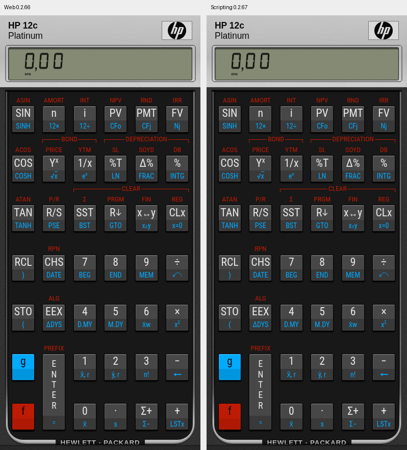
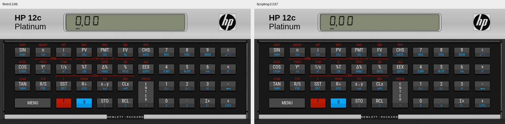

> Atualização: a importação real da 0.2.67 foi rejeitada no iPhone. O HTTP/ZIP válido registrado abaixo não comprovava importabilidade. Veja a [investigação e correção 0.2.68](import-fix.md), com script.json, extensão canônica .scripting e diretório GitHub completo.

# Scripting 0.2.67 — resultado de validação

Base aprovada: main `0c9253c9f07622af02d3388a10a9fe2ebba66ede`, 0.2.66. Checkout e remoto estavam iguais, limpos; sem skills em .agents/skills nem alterações concorrentes. Apenas variante de integração: nenhum CSS, geometria, textura ou motor financeiro alterado. O dist pré-existente era antigo; a comparação utilizou uma compilação isolada do commit aprovado, extraída com git archive em /tmp/hp12c-baseline.

| Verificação | Resultado |
| --- | --- |
| Testes JS/integração Vitest | 217 passaram, incluindo 7 novos da ponte |
| Mesma suíte com Rust/WASM instalado | 217 passaram |
| Visor/cópia | 24 passaram |
| Entrega Sites | 4 passaram |
| TypeScript e builds web/Scripting | passaram |
| Navegador web existente | 13 cenários passaram; inclui Rust ativo, fallback JS, PWA offline, memória/gestos e geometria |
| Navegador variante local com ponte simulada | 11 cenários passaram; nenhum erro de console/página |
| Comparação com web aprovada | zero pixels diferentes em 320×568, 393×852, 402×874, 852×393, 1280×800 |
| Rust cargo/recompilação WASM | não executados: toolchain ausente; binário e fontes Rust intactos |
| iPhone/Scripting/WKWebView físico | não executado: aparelho/runtime indisponível |

Os testes existentes cobrem RPN/ALG, f/g, STO/RCL, TVM, fluxos NPV/IRR, programas, datas, FIX/RND, pilha e erro; isso não demonstra equivalência total ao firmware HP. O pacote escolhe explicitamente o mesmo motor JavaScript, sem buscar WASM, e desliga somente seu service worker. A web mantém seu motor híbrido e PWA.

Ponte simulada: inicialização offline, quatro toques RPN com quatro chamadas hápticas, repetição de teclado ignorada, reabertura em contexto sem localStorage preservando X, desligamento persistente da vibração, exportação JSON, restauração inválida/cancelada sem mudança, restauração válida atômica, falha de salvamento visível com estado anterior preservado e exportação disponível, recuperação/retry. Unidade: snapshots de 100 entradas rápidas, revisão concorrente rejeitada, cópia anterior, leitura corrompida e tamanho/chaves inválidos. Gestos CDP, rotação e safe areas sintéticas, teclado rápido 1234567890 conferidos. Os limites visuais das teclas e as caixas geométricas coincidem com a base.

## Ambiente e limite offline

Browser plugin not available. Playwright já disponível em `/opt/codex/cua_node/lib/node_modules/playwright`; Chromium `/usr/bin/chromium`; sem instalação. O teste abre `http://hp12c.local/` num contexto offline e entrega cada recurso diretamente dos arquivos do pacote via interceptação local. Nenhuma solicitação externa, service worker ou WASM na variante. É demonstração do frontend e de seus recursos locais sem rede, com transporte/ponte simulados.

Ação bloqueada: navegar Chromium para `file:///workspace/hp12c-platinum/dist/scripting/HP12C%20Platinum/web/index.html`. Resultado: **negada** com `net::ERR_BLOCKED_BY_ADMINISTRATOR`; página não carregada. Não houve mudança da política nem nova tentativa dessa navegação. A validação por transporte simulado é uma verificação independente; não comprova `WebViewController.loadFile` nem a importação do ZIP no iPhone.

Validação nativa pendente: importar no Scripting, carregar por file://, tela cheia/safe areas físicas e rotação, haptics reais, seletor Arquivos e fechamento/reabertura pelo sistema. Storage.set confirma imediatamente, mas a documentação diz que a escrita física é assíncrona: encerramento forçado imediato não tem garantia absoluta; conservar backup externo. MENU é visível em paisagem no layout aprovado; não se mudou a face retrato para acrescentar controles.

## Reproduzir

```
npm run test:engine
npm run test:wasm
npm run test:display
npm run test:sites
npx tsc --noEmit
npm run build
npm run build:scripting
HP12C_PLAYWRIGHT=/opt/codex/cua_node/lib/node_modules/playwright/index.js node qa/scripting/browser.mjs
```

O comparativo espera a base compilada em `/tmp/hp12c-baseline/dist/client`. Artefatos sintéticos: browser-results.json, web-browser-results.json, visual-results.json. Capturas abaixo foram inspecionadas; texto/cores/fontes/recortes iguais. Não representam iPhone físico.




## Publicação

Implementação `1f505596135cef7104d45ccabe8076327ecc8ebd` enviada a main; Pages publicado e Vercel produção READY em `dpl_BjbYDKCphpmTUKLdjj39nxcRSFsQ`, domínio original https://hp12c-platinum-one.vercel.app/ . O ZIP e SHA256SUMS são gerados e publicados no diretório downloads/ do GitHub Pages original pelo workflow, sem mudar a face web.

Upload do ZIP para GitHub Releases negado com HTTP401 Bad credentials em uploads.github.com. Não foi repetido nem criada credencial; consulta ao ID423589556 retornou404 e a release não aparece na lista. Não existe release confirmada. A distribuição por Pages usa a publicação já autorizada e não depende de anexos Releases.
